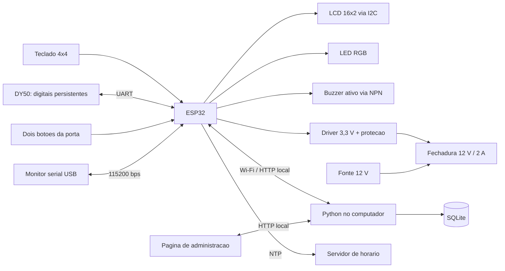

# Sistema Embarcados — controle de acesso com ESP32

Projeto acadêmico de armário/porta com senha individual ou impressão digital,
cadastro e administração local, indicadores, alertas sonoros e histórico por Wi-Fi.

**Comece por:** [escopo](docs/ESCOPO.md), [lista completa de materiais](docs/MATERIAIS.md), [montagem](docs/MONTAGEM.md)
e [roteiro de testes](docs/TESTES.md).

A entrega passou por [auditoria de dois agentes independentes](docs/AUDITORIA.md),
com correções, reavaliação e ampliação dos testes automatizados.

## O que foi entregue

| Pasta | Conteúdo |
|---|---|
| `firmware/ControleAcesso` | Sketch para Arduino IDE, configuração e lógica da porta |
| `servidor` | Servidor Python, banco SQLite criado ao executar e painel web |
| `docs` | Escopo, montagem, operação e validação |
| `tests` | Testes HTTP do servidor e testes C++ da máquina de estados |

O firmware vem com **`LOCK_MODE = 0`**: telas, sensores, credenciais e auditoria
funcionam, mas a saída de potência permanece desligada. Habilite o acionamento
somente após identificar o mecanismo e o regime elétrico da trava na bancada.

## Arquitetura



Os cadastros ficam na flash do ESP32; o DY50 guarda os modelos biométricos. A
fila de até 128 eventos fica em RAM. Rede e HTTP rodam em tarefa separada do
controle da porta. O sistema aceita credenciais locais mesmo sem o servidor.

## 1. Preparar o servidor

Requer Python 3.9 ou superior, sem `pip install` nem dependências externas.
Antes de iniciar, defina `ADMIN_PIN` e `DEVICE_KEY` no ambiente, com os mesmos
valores do `Config.h` local. A senha deve ter 10 dígitos; a chave, ao menos 16
caracteres. Consulte `.env.example` como referência; o arquivo não é carregado
automaticamente. Os zeros do exemplo não são uma senha pessoal fornecida.

No macOS/Linux, para informar os valores sem colocá-los no histórico do shell:

```sh
read -r -s 'ADMIN_PIN?Senha de administrador (10 dígitos): '; export ADMIN_PIN
read -r -s 'DEVICE_KEY?Chave do dispositivo: '; export DEVICE_KEY
```

Esses dois comandos usam `zsh`, o shell padrão do macOS. Em Bash, use
`read -r -s -p 'Senha: ' ADMIN_PIN` e o equivalente para `DEVICE_KEY`, seguido de
`export ADMIN_PIN DEVICE_KEY`. No PowerShell, defina `$env:ADMIN_PIN` e
`$env:DEVICE_KEY` para esta sessão antes de executar Python.

Abra o terminal na pasta deste projeto e execute:

```sh
python3 servidor/server.py --host 0.0.0.0 --port 8080
```

No Windows, se necessário, substitua `python3` por `py -3`.
Abra [o painel local](http://127.0.0.1:8080) no navegador do computador.
Entre com a senha de administrador definida no projeto.

Para o ESP32 alcançar esse servidor:

1. Coloque computador e ESP32 na mesma rede Wi-Fi, sem isolamento entre clientes.
2. Descubra o IP local do computador: Windows `ipconfig`; no macOS, Ajustes do
   Sistema → Wi-Fi → Detalhes → TCP/IP. Reserve esse IP no roteador se possível.
3. Em `Config.h`, use esse IP em `SERVER_URL`, por exemplo `http://192.168.1.100:8080`.
   **Não use `localhost` ou `127.0.0.1` no ESP32**: apontariam para a própria placa.
4. Se o firewall perguntar, permita Python somente na rede privada usada na montagem.

O banco `servidor/historico.sqlite3` surge automaticamente. Copie esse arquivo
com o servidor parado para guardar o histórico. A tela mostra os últimos 200
eventos por consulta; ao filtrar por ID, busca no histórico inteiro e retorna os
200 mais recentes daquele ID. Todos os recebidos permanecem no SQLite.

Servidor e firmware devem usar a mesma senha de administrador e chave de
dispositivo. O servidor não contém senha pessoal padrão: exige as variáveis
de ambiente. `Config.h` é local e ignorado pelo Git; somente o modelo
`Config.example.h` é versionado. Não comite senhas, redes pessoais ou bancos reais.

Este servidor HTTP é para a LAN do protótipo. Credenciais trafegam sem TLS;
a senha de redefinição fica no SQLite enquanto o comando está pendente e é
removida ao receber o resultado. O histórico nunca contém a senha.

## 2. Preparar a Arduino IDE

1. Instale a Arduino IDE 2.x.
2. Arquivo → Preferências → URLs adicionais para Gerenciadores de Placas:
   `https://espressif.github.io/arduino-esp32/package_esp32_index.json`.
3. Ferramentas → Placa → Gerenciador de Placas: instale **esp32 by Espressif Systems**.
4. Selecione **ESP32 Dev Module** para a DevKitC com WROOM-32E clássico.
   Este mapa não é para ESP32-C3, S3 ou módulos WROVER.
5. No Gerenciador de Bibliotecas, instale:

| Biblioteca | Autor / versão usada na validação |
|---|---|
| Adafruit Fingerprint Sensor Library | Adafruit — 2.1.4 |
| Keypad | Mark Stanley / Alexander Brevig — 3.1.1 |
| LiquidCrystal I2C | Frank de Brabander — 1.1.2 |
| ArduinoJson | Benoit Blanchon — 7.4.3 |

WiFi, HTTPClient, Preferences, Wire, mbedTLS e FreeRTOS já vêm no pacote ESP32.
O pacote de placa usado na compilação está em `docs/VALIDACAO.md`.

6. Copie `firmware/ControleAcesso/Config.example.h` para `Config.h`, na mesma pasta,
   se ainda não houver configuração local. A cópia local existente não deve ser
   sobrescrita. Configure seus próprios 10 dígitos em `ADMIN_PIN` e uma chave de
   dispositivo com pelo menos 16 caracteres; use os mesmos valores no servidor.
   Abra `firmware/ControleAcesso/ControleAcesso.ino`. Os arquivos `.h` devem ficar
   na mesma pasta do `.ino`.
7. Em `Config.h`, configure Wi-Fi, IP do servidor, chave do dispositivo, endereço
   do LCD e tipo do LED. Mantenha `LOCK_MODE = 0` no início.
8. Clique em **Verificar**. Depois de montar os circuitos de baixa tensão,
   selecione a porta USB correta e clique em **Carregar**.

**Configurações principais:**

| Constante | Função |
|---|---|
| `ADMIN_PIN` | Senha de 10 dígitos escolhida na conversa |
| `WIFI_SSID`, `WIFI_PASSWORD` | Rede de 2,4 GHz |
| `SERVER_URL` | IP local e porta do computador |
| `DEVICE_KEY` | Chave que autentica a placa no servidor |
| `LCD_ADDRESS` | Normalmente 0x27; confirmar o adaptador |
| `RGB_COMMON_ANODE` | `false` para cátodo comum, `true` para ânodo comum |
| `LOCK_MODE` | 0 simulação, 1 pulso, 2 energizada até abrir/expirar |
| `LOCK_PULSE_MS` | Duração do pulso a validar, não é a janela de 1 minuto |
| `LOCK_ON` | HIGH/LOW conforme entrada do driver |
| `BUZZER_PIN` | GPIO2: buzzer ativo via transistor, sem pull-up de 5 V |

## 3. Operação no teclado

- Acesso: senha individual de 6 dígitos + `#`, ou dedo cadastrado.
- Administração: senha de 10 dígitos + `#`, com porta fechada e ciclo encerrado.
- `*` limpa todos os dígitos da entrada atual; `D` cancela cadastro/administração
  e sai. Na tela de acesso em espera, `D` limpa a entrada; não cancela uma
  autorização já concedida.
- Uma digital válida pode autorizar mesmo se houver senha parcialmente digitada;
  a entrada parcial é descartada somente depois de autorizar.
- Menu: `1` cadastra; `2` desativa por ID; `3` reativa por ID; `D` sai.
- Nas alterações de estado, digite o ID e `#`; depois `#` confirma ou `D` cancela.
- Cadastro: retire o dedo, coloque, retire, coloque o mesmo dedo, crie a senha,
  confirme com `#`, repita e confirme novamente.
- Não há redefinição de senha no menu do teclado.
- O menu/cadastro expira em 60 segundos sem interação. Colocar o dedo nas etapas
  corretas renova o prazo. Em erro, o display orienta a repetir/cancelar.

IDs vão de 001 a 100. Inativar mantém os registros e a digital; reativar mantém as
credenciais. Senhas de pessoas inativas continuam reservadas. ID só é consumido
depois de concluir o cadastro. Não apague a flash/NVS nem esvazie o DY50 após o
cadastro, pois isso quebraria a correspondência entre IDs e digitais.

O LCD mostra o ID da autorização e mantém esse ID enquanto a porta está aberta.
Os botões só confirmam fechamento da porta, não o engate interno da trava.

O projeto **não usa motor adicional**. O buzzer dá três bipes se a pessoa não
abrir em 1 minuto; após 5 minutos de porta aberta, dá bipes a cada 2 segundos até
fechar. O alerta sonoro funciona mesmo com `LOCK_MODE=0`, que desabilita somente
o acionamento da fechadura.

## 4. Redefinir senha pelo computador

### Pela página

Entre no painel → “Redefinir senha” → selecione o ID → nova senha → confirmação
→ “Enviar redefinição”. A solicitação ficará **pendente** enquanto o ESP32 não
confirmar. “Aplicada” significa gravação confirmada; “Recusada” traz o motivo,
como senha em uso ou dispositivo ocupado em um cadastro.

### Por USB

Na Arduino IDE, abra Ferramentas → Monitor Serial. Selecione **115200 bps** e
final de linha **Nova linha**. Digite, substituindo os valores entre `< >`:

```text
AUTH <senha-de-administrador>
STATUS
LIST
RESET 1 654321 654321
LOGOUT
```

`RESET` exige confirmação igual, senha numérica de 6 dígitos e exclusiva.
Não exige rede. `STATUS` informa fila, perdas e modo da trava. A sessão USB expira
em 5 minutos sem comandos. Abrir a porta serial pode reiniciar a placa dependendo
do driver/terminal: isso perde a fila RAM; prefira a página durante a demonstração.

## 5. Horário e indisponibilidade

NTP usa UTC no ESP32; a página converte para o horário local do navegador.
Se não houver internet na inicialização, o acesso continua e os eventos ficam
sem horário, com sessão e tempo ligado. Não atribuímos retroativamente uma data
inventada. Depois da sincronização, os novos eventos passam a ter data/hora.

Com o computador desligado, a fila guarda até 128 eventos e tenta reenviar.
Só remove eventos após o servidor confirmar. Fila cheia descarta novos eventos;
isso é um limite simplificado para este trabalho. Reiniciar perde a fila, conforme
decidido. Na inicialização, o ESP32 reenvia um resumo dos cadastros para o painel.

## Validação e pendências físicas

Consulte [VALIDACAO.md](docs/VALIDACAO.md) para os comandos realmente executados.
O pacote não é prova de funcionamento em hardware. Permanecem para a montagem:
níveis UART e pinagem DY50, endereço LCD, resistores/LED, polaridade do driver,
alimentação, mecanismo/regime da trava e roteiro completo de bancada.

## Repositório e configuração pessoal

O projeto é distribuído com configuração de exemplo. O arquivo local `Config.h`,
variáveis `.env`, bancos de histórico, logs e binários não são versionados.
Para testes de software, basta executar `python3 -m unittest discover -s tests -v`:
a suíte usa o template e não exige credenciais pessoais ou placa conectada.
Não há evidência de teste físico nem de CI hospedada apenas por publicar o código.

## Fontes consultadas

- [ESP32-DevKitC V4 — Espressif](https://docs.espressif.com/projects/esp-dev-kits/en/latest/esp32/esp32-devkitc/user_guide.html)
- [ESP32-WROOM-32E — datasheet](https://documentation.espressif.com/esp32-wroom-32e_esp32-wroom-32ue_datasheet_en.html)
- [Preferences — Espressif](https://docs.espressif.com/projects/arduino-esp32/en/latest/api/preferences.html)
- [DY50 — produto Eletrogate](https://www.eletrogate.com/modulo-leitor-biometrico-impressao-digital-dy50)
- [DY50 — tutorial Eletrogate](https://blog.eletrogate.com/modulo-leitor-biometrico-dy-50/)
- [Biblioteca Adafruit Fingerprint](https://github.com/adafruit/Adafruit-Fingerprint-Sensor-Library)
- [Biblioteca Keypad](https://github.com/Chris--A/Keypad)

A descrição da fechadura fornecida pelo usuário é a fonte de 12 V / 2 A; o anúncio
não pôde ser acessado. Não foi obtida uma especificação do tempo da bobina.
