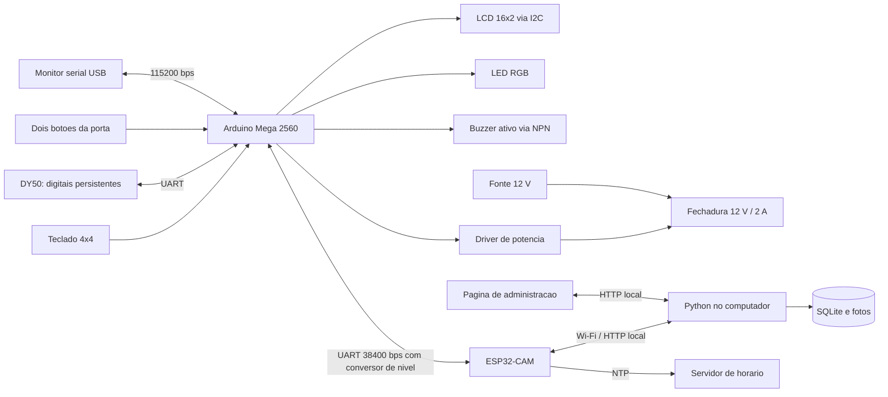

# Sistema Embarcados — controle de acesso com Arduino Mega e ESP32-CAM

Projeto acadêmico de porta com senha individual ou impressão digital, cadastro e
administração local, indicadores, alertas sonoros, uma foto por acesso autorizado
e histórico no servidor da rede local.

**Comece por:** [escopo](docs/ESCOPO.md), [lista de materiais](docs/MATERIAIS.md),
[guia de montagem](docs/MONTAGEM.md) e [roteiro de testes](docs/TESTES.md).

> **Status:** Os dois sketches compilaram em 30/10/2026 (ver [docs/VALIDACAO.md](docs/VALIDACAO.md));
> falta validação com as placas e componentes reais. Mantenha `LOCK_MODE=0`
> e a fechadura desconectada durante a primeira bancada. Antes de ligar qualquer
> circuito, siga o [guia de montagem](docs/MONTAGEM.md).

## Mega + ESP32-CAM: preparação para bancada

O Mega executa o controle local, o teclado, a digital, o LCD, os botões e os
indicadores. A ESP32-CAM recebe os eventos por UART, captura a imagem e envia o
evento e a foto ao servidor na rede local. O servidor Python grava o histórico e as
fotos em SQLite e oferece o painel de administração.

1. Instale os cores Arduino AVR **1.8.8** e ESP32 **3.3.12**. Instale as
   bibliotecas Crypto **0.4.0**, Adafruit Fingerprint **2.1.4**, Keypad **3.1.1**,
   LiquidCrystal I2C **1.1.2** e ArduinoJson **7.4.3**. As pastas de sketch são
   `firmware/MegaControlador` e `firmware/Esp32CamRede`.
2. Copie `Config.example.h` para `Config.h` em cada pasta, caso ainda não exista.
   No Mega, defina localmente uma senha de administrador de 10 dígitos. Na CAM,
   defina SSID, senha Wi-Fi, URL do servidor na LAN, identificador e chave do
   dispositivo. Os arquivos `Config.h` são ignorados pelo Git. **Os valores de
   exemplo não são credenciais prontas.**
3. No computador, configure as variáveis `ADMIN_PIN` e `DEVICE_KEY` (procedimento
   na seção 1). Inicie o servidor para receber a CAM pela LAN. A porta padrão é
   `8080`; a URL da CAM deve apontar para o IP do computador, não para `127.0.0.1`.
   No próprio computador, o painel abre em `http://127.0.0.1:8080/`.
4. Compile para `arduino:avr:mega` e `esp32:esp32:esp32cam`. Antes de gravar,
   confira a placa de programação, os níveis lógicos e a alimentação conforme
   [montagem](docs/MONTAGEM.md). Em Mac ARM sem Rosetta, o compilador AVR Intel
   fornecido para macOS pode não executar; a compilação do Mega foi feita
   em container Linux com Arduino CLI e o mesmo core AVR.
5. Execute `python3 -m unittest discover -s tests -v`. Os testes C++ da máquina de
   estados do Mega também podem ser executados com `c++ -std=c++11 tests/test_door.cpp
   -o /tmp/test_door && /tmp/test_door`; em macOS pode ser necessário acrescentar
   `-isysroot "$(xcrun --show-sdk-path)"` ao compilador host. Para garantir que os
   testes que usam bibliotecas reais não sejam ignorados, siga a preparação abaixo.

### Bibliotecas para testes digitais em computador

Os testes de rede/servidor da CAM usam ArduinoJson **7.4.3** e o teste do DY50
usa Adafruit Fingerprint **2.1.4**. Para preparar cópias em um diretório novo,
com Git e acesso à internet, execute a partir da raiz do projeto:

```sh
python3 scripts/bootstrap-test-libs.py /tmp/controle-test-libs
CONTROLE_TEST_LIBS=/tmp/controle-test-libs CONTROLE_TEST_STRICT=1 python3 -m unittest discover -s tests -v
```

O script verifica os commits fixados das duas versões e não sobrescreve um
destino existente. Escolha outro caminho ou remova sua própria cópia temporária
antes de repetir. Python 3 e um compilador C++ host também são necessários.
O resolvedor verifica os metadados de versão e os arquivos exigidos diretamente
por cada teste. Se essa verificação falhar, o modo estrito
(`CONTROLE_TEST_STRICT=1`) falha o teste; no modo normal, ele é ignorado.
Dependências transitivas não são verificadas: se faltarem, a compilação falha
em ambos os modos. Confira também o total de `skipped`. O bootstrap fixa o código baixado; o resolvedor dos
testes verifica os arquivos e a versão declarada, não a integridade de cópias
locais modificadas. São testes simulados, não validação física.

Mantenha `LOCK_MODE=0` e a fechadura desconectada durante a primeira bancada.
As filas são limitadas e voláteis: eventos ou fotos podem ser perdidos em fila
cheia ou reinício. A rede HTTP não cifra credenciais nem fotos; use uma LAN
confiável. O banco contém imagens e deve ser protegido e mantido fora do Git.
A CAM solicita ao Mega uma prova de frescor depois da captura; se ela não chegar
ou o prazo tiver expirado, o evento segue sem foto. A verificação foi testada com
dublês e depende de relógio, entropia e comportamento real da câmera; a UART não
é autenticada. Falhas de entrega aparecem no monitor serial da CAM, e o item
permanece na fila para reenvio. Se o servidor rejeitar o mesmo item com 400, 409,
413 ou 422 cinco vezes seguidas, em pelo menos 30 s com Wi-Fi contínuo, a CAM o
descarta: se o evento já foi aceito, perde-se só a foto. A perda é contada em
`rejected` (evento) ou `photo_rejected` (foto) no heartbeat, e o painel exibe
aviso. Respostas 401, 403, 404 e demais erros mantêm o item na fila.
O servidor bloqueia temporariamente o mesmo IP e papel após dez falhas de
autenticação em 60 s, inclusive tentativas válidas durante esse período; limites
de conexão não substituem criptografia ou proteção do banco e seus backups.
Em sistemas POSIX, novos bancos são criados com permissões de até `0600`;
permissões de bancos existentes não são alteradas. O servidor exige um caminho
persistente e rejeita nomes vazios, `:memory:` e URIs SQLite iniciadas por
`file:`. A reabertura do caminho não elimina corridas envolvendo links simbólicos
e a proteção não se estende automaticamente aos backups.

## O que foi entregue

| Pasta | Conteúdo |
|---|---|
| `firmware/MegaControlador` | Sketch do Arduino Mega 2560: controle da porta, teclado, DY50, LCD, RGB, buzzer, botões e cadastros em EEPROM |
| `firmware/Esp32CamRede` | Sketch da ESP32-CAM: Wi-Fi, NTP, fila de eventos, captura de foto e envio ao servidor |
| `servidor` | Servidor Python (biblioteca padrão), banco SQLite criado ao executar, painel web e fotos |
| `docs` | Escopo, materiais, montagem, roteiro de testes (ensaios de bancada) e registro de validação |
| `tests` | Testes do servidor, dos sketches com dublês e C++ da máquina de estados do Mega |

O firmware vem com **`LOCK_MODE = 0`**: telas, sensores, credenciais e auditoria
funcionam, mas a saída de potência permanece desligada. Habilite o acionamento
somente após identificar o mecanismo e o regime elétrico da trava na bancada.

## Arquitetura



Os cadastros ficam na EEPROM do Mega; o DY50 guarda os modelos biométricos. As
filas são em RAM: até 16 eventos no Mega e até 8 itens na CAM. A rede fica na CAM,
e o Mega continua controlando a porta sem depender do Wi-Fi. O sistema aceita
credenciais locais mesmo sem o servidor.

## 1. Preparar o servidor

Requer Python 3.9 ou superior, sem `pip install` nem dependências externas.
Antes de iniciar, defina `ADMIN_PIN` e `DEVICE_KEY` no ambiente, com os mesmos
valores do `Config.h` local. A senha deve ter 10 dígitos; a chave, ao menos 16
caracteres. Consulte `.env.example` como referência; o arquivo não é carregado
automaticamente. Os zeros do exemplo não são uma senha pessoal fornecida.

No macOS/Linux, para informar os valores sem colocá-los no histórico do shell:

```sh
read -r -s 'ADMIN_PIN?Senha de administrador (10 dígitos): '; export ADMIN_PIN
read -r -s 'DEVICE_KEY?Chave do dispositivo: '; export DEVICE_KEY
```

Esses dois comandos usam `zsh`, o shell padrão do macOS. Em Bash, use
`read -r -s -p 'Senha: ' ADMIN_PIN` e o equivalente para `DEVICE_KEY`, seguido de
`export ADMIN_PIN DEVICE_KEY`. No PowerShell, defina `$env:ADMIN_PIN` e
`$env:DEVICE_KEY` para esta sessão antes de executar Python.

Abra o terminal na pasta deste projeto e execute:

```sh
python3 servidor/server.py --host 0.0.0.0 --port 8080
```

No Windows, se necessário, substitua `python3` por `py -3`.
Abra [o painel local](http://127.0.0.1:8080) no navegador do computador.
Entre com a senha de administrador definida no projeto.

Para a ESP32-CAM alcançar esse servidor:

1. Coloque computador e ESP32-CAM na mesma rede Wi-Fi, sem isolamento entre clientes.
2. Descubra o IP local do computador: Windows `ipconfig`; no macOS, Ajustes do
   Sistema → Wi-Fi → Detalhes → TCP/IP. Reserve esse IP no roteador se possível.
3. Em `firmware/Esp32CamRede/Config.h`, use esse IP em `SERVER_URL`, por exemplo
   `http://192.168.1.100:8080`. **Não use `localhost` ou `127.0.0.1` na CAM**:
   apontariam para a própria placa.
4. Se o firewall perguntar, permita Python somente na rede privada usada na montagem.

O banco `servidor/historico.sqlite3` surge automaticamente. Copie esse arquivo
com o servidor parado para guardar o histórico. A tela mostra os últimos 200
eventos por consulta; ao filtrar por ID, busca no histórico inteiro e retorna os
200 mais recentes daquele ID. Todos os recebidos permanecem no SQLite.

Servidor e firmware devem usar a mesma senha de administrador e chave de
dispositivo. O servidor não contém senha pessoal padrão: exige as variáveis
de ambiente. `Config.h` é local e ignorado pelo Git; somente o modelo
`Config.example.h` é versionado. Não comite senhas, redes pessoais ou bancos reais.

Este servidor HTTP é para a LAN do protótipo. Credenciais trafegam sem TLS;
a senha de redefinição fica no SQLite enquanto o comando está pendente e é
removida ao receber o resultado. O histórico nunca contém a senha.

## 2. Preparar a Arduino IDE

1. Instale a Arduino IDE 2.x.
2. Arquivo → Preferências → URLs adicionais para Gerenciadores de Placas:
   `https://espressif.github.io/arduino-esp32/package_esp32_index.json`.
3. Ferramentas → Placa → Gerenciador de Placas: instale **Arduino AVR Boards** 1.8.8
   (para o Mega 2560) e **esp32 by Espressif Systems** 3.3.12 (para a ESP32-CAM).
4. Selecione **Arduino Mega or Mega 2560** para `firmware/MegaControlador` e
   **AI Thinker ESP32-CAM** (`esp32:esp32:esp32cam`) para `firmware/Esp32CamRede`.
   Confirme a variante da CAM e a pinagem real antes de gravar.
5. No Gerenciador de Bibliotecas, instale:

| Biblioteca | Versão usada na compilação |
|---|---|
| Crypto | 0.4.0 |
| Adafruit Fingerprint Sensor Library | 2.1.4 |
| Keypad | 3.1.1 |
| LiquidCrystal I2C | 1.1.2 |
| ArduinoJson | 7.4.3 |

WiFi, HTTPClient, Wire e FreeRTOS já vêm no pacote ESP32; o driver da câmera
(`esp32-camera`) também vem no pacote. Core usado na compilação: esp32 3.3.12
([registro](docs/VALIDACAO.md)).

6. Copie `Config.example.h` para `Config.h` em cada pasta de sketch, se ainda não
   houver configuração local. A cópia local existente não deve ser sobrescrita.
   Configure seus próprios 10 dígitos em `ADMIN_PIN` no Mega e a chave de
   dispositivo, com pelo menos 16 caracteres, na CAM e no servidor.
   Os arquivos `.h` devem ficar na mesma pasta do `.ino`.
7. Mantenha `LOCK_MODE = 0` no início. Depois de montar os circuitos de baixa tensão,
   selecione a porta USB correta de cada placa e clique em **Carregar**.

**Configurações principais:**

Mega (`firmware/MegaControlador/Config.h`):

| Constante | Função |
|---|---|
| `ADMIN_PIN` | Senha de administrador de 10 dígitos, igual à do servidor |
| `LOCK_MODE` | 0 simulação (sem acionamento), 1 pulso, 2 energizada até abrir/expirar |
| `LOCK_PULSE_MS` | Duração do pulso a validar, não é a janela de 60 s |
| `LOCK_ON` | HIGH/LOW conforme entrada do driver |
| `LCD_ADDRESS` | Normalmente 0x27; confirmar o adaptador |
| `RGB_COMMON_ANODE` | `false` para cátodo comum, `true` para ânodo comum |

CAM (`firmware/Esp32CamRede/Config.h`):

| Constante | Função |
|---|---|
| `WIFI_SSID`, `WIFI_PASSWORD` | Rede de 2,4 GHz |
| `SERVER_URL` | IP local e porta do computador |
| `DEVICE_KEY` | Chave que autentica a placa no servidor; igual à do servidor |
| `DEVICE_ID` | Identificador do dispositivo enviado ao servidor |

## 3. Operação no teclado

- Acesso: senha individual de 6 dígitos + `#`, ou dedo cadastrado.
- Administração: senha de 10 dígitos + `#`, com porta fechada e ciclo encerrado.
- `*` limpa todos os dígitos da entrada atual; `D` cancela cadastro/administração
  e sai. Na tela de acesso em espera, `D` limpa a entrada; não cancela uma
  autorização já concedida.
- Uma digital válida pode autorizar mesmo se houver senha parcialmente digitada;
  a entrada parcial é descartada somente depois de autorizar.
- Menu: `1` cadastra; `2` desativa por ID; `3` reativa por ID; `D` sai.
- Nas alterações de estado, digite o ID e `#`; depois `#` confirma ou `D` cancela.
- Cadastro: retire o dedo, coloque, retire, coloque o mesmo dedo, crie a senha,
  confirme com `#`, repita e confirme novamente.
- Não há redefinição de senha no menu do teclado.
- O menu/cadastro expira em 60 segundos sem interação. Colocar o dedo nas etapas
  corretas renova o prazo. Em erro, o display orienta a repetir/cancelar.

IDs vão de 001 a 100. Inativar mantém os registros e a digital; reativar mantém as
credenciais. Senhas de pessoas inativas continuam reservadas. ID só é consumido
depois de concluir o cadastro. Não apague a EEPROM do Mega nem esvazie o DY50 após o
cadastro, pois isso quebraria a correspondência entre IDs e digitais.

O LCD mostra o ID da autorização e mantém esse ID enquanto a porta está aberta.
Os botões só confirmam fechamento da porta, não o engate interno da trava.

O projeto **não usa motor adicional**. O buzzer dá três bipes se a pessoa não
abrir em 60 s; após 5 minutos de porta aberta, dá bipes a cada 2 segundos até
fechar. O alerta sonoro funciona mesmo com `LOCK_MODE=0`, que desabilita somente
o acionamento da fechadura.

## 4. Redefinir senha pelo computador

### Pela página

Entre no painel → “Redefinir senha” → selecione o ID → nova senha → confirmação
→ “Enviar redefinição”. A solicitação ficará **pendente** enquanto o Mega não
confirmar. “Aplicada” significa gravação confirmada; “Recusada” traz o motivo,
como senha em uso ou dispositivo ocupado em um cadastro.

### Por USB

Conecte o USB ao Mega. Na Arduino IDE, abra Ferramentas → Monitor Serial. Selecione
**115200 bps** e final de linha **Nova linha**. Digite, substituindo os valores
entre `< >`:

```text
AUTH <senha-de-administrador>
STATUS
LIST
RESET 1 654321 654321
LOGOUT
```

`RESET <id> <senha> <repetição>` exige a mesma senha duas vezes, senha numérica de
6 dígitos e exclusiva. Não exige rede. `STATUS` informa fila, perdas e modo da
trava; `LIST` mostra cada ID como ativo ou inativo. A sessão USB expira em 5 minutos
sem comandos. Abrir a porta serial pode reiniciar a placa dependendo do driver ou
terminal: isso perde a fila RAM; prefira a página durante a demonstração.

## 5. Horário e indisponibilidade

A CAM sincroniza o horário por NTP em UTC; a página converte para o horário local
do navegador. Se não houver internet na inicialização, o acesso continua e os
eventos ficam sem horário, com sessão e tempo desde a inicialização. Não atribuímos
retroativamente uma data inventada. Depois da sincronização, os novos eventos
passam a ter data/hora.

Com o computador desligado, a CAM mantém até 8 itens na fila (com foto quando
houver) e o Mega mantém até 16 eventos. O Mega retira um evento quando a CAM aceita
o item na fila; a CAM retira o item somente depois que o servidor confirma.
Fila cheia descarta o evento novo e conta a perda; isso é um limite simplificado
para este trabalho. Reiniciar perde as filas, conforme decidido.

## Validação e pendências físicas

[VALIDACAO.md](docs/VALIDACAO.md) registra os comandos executados e o nível de
evidência de cada resultado. O pacote não é prova de funcionamento em hardware.
Permanecem pendentes: níveis UART do DY50 e entre Mega e CAM, endereço LCD,
resistores/LED, polaridade do driver, alimentação, mecanismo/regime da trava,
captura e envio de foto pela câmera. A montagem e o roteiro de comunicação estão em
[MONTAGEM.md](docs/MONTAGEM.md) (seção 5); os ensaios funcionais de bancada estão em
[TESTES.md](docs/TESTES.md).

## Repositório e configuração pessoal

O projeto é distribuído com configuração de exemplo. O arquivo local `Config.h`,
variáveis `.env`, bancos de histórico, logs e binários não são versionados.
Para testes de software, basta executar `python3 -m unittest discover -s tests -v`:
a suíte usa o template e não exige credenciais pessoais ou placa conectada.
Não há evidência de teste físico nem de CI hospedada apenas por publicar o código.

## Fontes consultadas

- [Arduino Mega 2560 — documentação oficial](https://docs.arduino.cc/hardware/mega-2560/)
- [Driver esp32-camera — Espressif](https://github.com/espressif/esp32-camera)
- [DY50 — produto Eletrogate](https://www.eletrogate.com/modulo-leitor-biometrico-impressao-digital-dy50)
- [DY50 — tutorial Eletrogate](https://blog.eletrogate.com/modulo-leitor-biometrico-dy-50/)
- [Biblioteca Adafruit Fingerprint](https://github.com/adafruit/Adafruit-Fingerprint-Sensor-Library)
- [Biblioteca Keypad](https://github.com/Chris--A/Keypad)

A descrição da fechadura fornecida pelo usuário é a fonte de 12 V / 2 A; o anúncio
não pôde ser acessado. Não foi obtida uma especificação do tempo da bobina.
