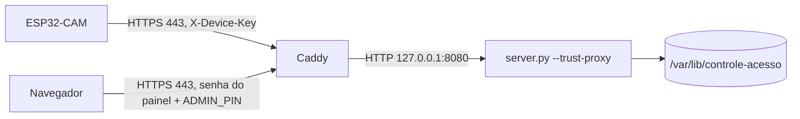

# Servidor na nuvem com HTTPS

Alternativa ao servidor no computador da LAN: o mesmo `servidor/server.py` roda numa VM (testado com Ubuntu 24.04 na AWS), atrás do **Caddy**, que tira o certificado da Let's Encrypt sozinho e fala HTTPS na porta 443. A CAM passa a mandar eventos e fotos pela internet, cifrados e com o certificado conferido.



## O que muda em relação à LAN

| item | LAN | nuvem |
|---|---|---|
| `SERVER_URL` da CAM | `http://192.168.x.x:8080` | `https://<domínio>` (sem porta) |
| transporte | HTTP em claro | TLS, raízes ISRG X1/X2 em `firmware/Esp32CamRede/ServerCA.h` |
| prazos da CAM | 0,6 s conexão, 0,9 s resposta | 5 s conexão, 5 s resposta (8 s na foto), handshake até 8 s |
| conexão | uma por pedido | um cliente TLS reaproveitado (keep-alive do Caddy) |
| painel | `ADMIN_PIN` | senha do navegador (Caddy) **e** `ADMIN_PIN` |
| limite de tentativas | por IP do peer | por IP do `X-Forwarded-For` (`--trust-proxy`) |

As rotas `/api/device/*` não pedem a senha do painel: a CAM continua só com a `X-Device-Key`. Todo o resto (página, `/api/admin/*`, fotos) pede as duas.

## Pré-requisitos

1. VM Ubuntu 24.04 com IP público e portas **80 e 443** abertas para a internet (a 80 é só para a Let's Encrypt validar o domínio). Porta 22 só para o seu IP.
2. Um nome de domínio apontando para o IP da VM. Um subdomínio grátis do DuckDNS serve.

## Instalação

Na VM:

```sh
git clone <este repositório> controle && cd controle
sudo DOMINIO=seu-nome.duckdns.org PAINEL_USUARIO=admin bash deploy/instalar.sh
```

O script instala Python e Caddy, cria o usuário de sistema `controle`, copia `servidor/` para `/opt/controle-acesso`, gera `/etc/controle-acesso.env` com `ADMIN_PIN` (10 dígitos) e `DEVICE_KEY` aleatórios, sobe o serviço `controle-acesso` e configura o Caddy. Ele pede a senha do painel uma vez. **Anote o que ele imprime**: o `DEVICE_KEY` vai para o `Config.h` da CAM e o `ADMIN_PIN` para o do Mega.

Para atualizar o código depois: `git pull` e o mesmo comando. O `.env`, a senha do painel e o banco são preservados.

Com domínio DuckDNS, acrescente `DUCKDNS_TOKEN=<token>` ao comando (ou crie `/etc/controle-acesso-duckdns.env` com `DUCKDNS_DOMINIO=<nome sem .duckdns.org>` e `DUCKDNS_TOKEN=<token>`, modo 0600). A VM passa a atualizar o próprio IP no boot e a cada 5 min (`duckdns.timer`): sem isso, depois de um stop/start o IP público muda e o domínio fica apontando para o endereço antigo.

## Testar o servidor sem a placa

```sh
DEVICE_KEY=<chave> python3 scripts/testar-servidor.py https://seu-nome.duckdns.org
DEVICE_KEY=<chave> PAINEL_USUARIO=admin PAINEL_SENHA=<senha> ADMIN_PIN=<pin> python3 scripts/testar-servidor.py https://seu-nome.duckdns.org
```

Confia só nas raízes do `ServerCA.h` (as mesmas da CAM), reaproveita a conexão como a CAM e usa apenas pedidos que não gravam nada. Não manda heartbeat de propósito: com outro `cam_boot_id`, enquanto a CAM real está ligada, o servidor somaria os contadores dela duas vezes. Com o painel, mostra há quantos segundos o aparelho foi visto. Sai com código 1 se algo falhar; um certificado de outra autoridade aparece como `FALHA: certificado não fecha nas raízes da CAM`.

## CAM

No `Config.h` da `firmware/Esp32CamRede`:

```cpp
constexpr char SERVER_URL[] = "https://seu-nome.duckdns.org";
constexpr char DEVICE_KEY[] = "<DEVICE_KEY do /etc/controle-acesso.env>";
```

O Wi-Fi da CAM precisa ter saída para a internet (NTP e 443). Certificado de outra autoridade que não a Let's Encrypt: trocar o texto de `ServerCA.h` pela raiz dela. O `Caddyfile` fixa `cert_issuer acme` para o Caddy não cair na ZeroSSL, cuja raiz a CAM não conhece.

### Primeira gravação em HTTPS: o que olhar no monitor serial

1. `CAM wifi conectado 192.168.x.x`: Wi-Fi ok. Sem essa linha o problema é SSID/senha, não TLS.
2. Em até ~15 s o painel mostra o aparelho em "dispositivos" (heartbeat). Se aparecer, TLS, certificado e `DEVICE_KEY` estão certos.
3. Se aparecer `CAM tls: falha -1, mbedtls <n> (<texto>), heap <h>, maior bloco <b>` (no máximo uma vez a cada 10 s):
   - texto com `X509` ou `verify`: certificado. Conferir se o servidor ainda é Let's Encrypt e se `ServerCA.h` tem X1 e X2.
   - texto com `memory`/`alloc`, ou `maior bloco` abaixo de ~40000: falta de heap no handshake com a câmera ligada.
   - `-1` sem texto: DNS ou porta 443 bloqueada na rede (Wi-Fi da faculdade costuma bloquear portas, não a 443).
4. `Fila CAM: ... HTTP rejeitado (possivel erro de configuracao...) (401)`: `DEVICE_KEY` diferente da do `/etc/controle-acesso.env`.
5. Acesso autorizado aparece no painel com foto: ponta a ponta ok.

O cliente TLS e o `HTTPClient` do caminho TLS são estáticos: o `~HTTPClient()` do core chama `stop()` no cliente, então com objeto local a conexão fecharia a cada pedido e a CAM refaria o handshake a cada poll de 3 s.

Simulação feita em 08/11/2026 contra o servidor real, com Python confiando só em X1+X2 e uma conexão keep-alive: handshake de 308 ms (TLS 1.3), depois heartbeat, cadastro, acesso, foto de 16 KB e poll de comando entre 22 e 50 ms cada, todos 200, e o painel mostrou o evento com foto. Os registros de teste foram apagados do banco.

## Operação

```sh
sudo systemctl status controle-acesso caddy
sudo journalctl -u controle-acesso -u caddy -f
sudo systemctl list-timers controle-acesso-backup.timer duckdns.timer
sudo ls -l /var/lib/controle-acesso/backups      # um arquivo por dia, 14 dias
```

O `controle-acesso-backup.timer` copia o banco todo dia às 03:30 (UTC) pela API de backup do SQLite, confere `PRAGMA integrity_check` e guarda 14 dias em `/var/lib/controle-acesso/backups` (contém fotos; modo 0600). O backup fica no mesmo disco: protege de banco corrompido e de exclusão por engano, não da perda da VM. Para levar uma cópia para fora: `scp -i <chave> ubuntu@<ip>:...` depois de `sudo cp` para a home.

Restaurar: `sudo systemctl stop controle-acesso`, copiar o arquivo do dia sobre `/var/lib/controle-acesso/historico.sqlite3` (dono `controle`, modo 0600) e `sudo systemctl start controle-acesso`.

## Limites

- O servidor continua de **um aparelho só** (`DEVICE_ID`) e com SQLite local; isto é hospedagem do protótipo, não a integração com o sistema do hospital.
- A UART entre Mega e CAM continua sem autenticação, como na LAN.
- Cadeia conferida em 07/11/2026 na VM real: folha → `YE2` → `Root YE` → `ISRG Root X2` → `ISRG Root X1`, e `openssl s_client -CAfile` só com X1+X2 (o conteúdo de `ServerCA.h`) devolve `Verify return code: 0`. São 4 certificados na cadeia; se a CAM falhar no handshake por memória, esse é o primeiro suspeito.
- Validado em 07/11/2026 com Caddy local (`tls internal`): CAM sem senha do painel = 200, painel sem senha = 401, senha sem PIN = 401, senha + PIN = 200. **Ainda não validado com a CAM real em HTTPS**; o handshake TLS com câmera ligada depende de heap e deve ser conferido no monitor serial.
